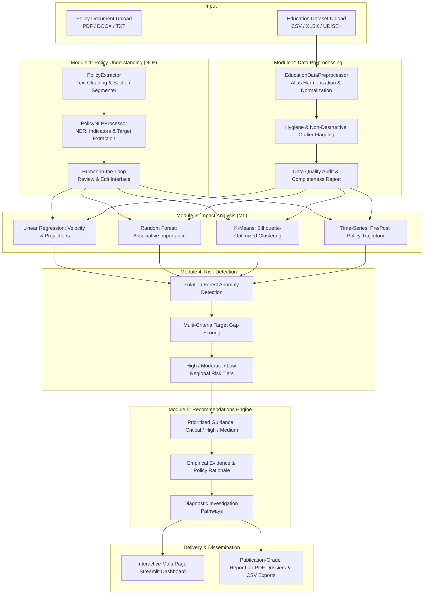

# Policy-to-Impact Intelligence System: Education Policy Analysis

**An NLP and Machine Learning-Based Framework for Education Policy Evaluation and Decision Support in India.**

An end-to-end research-grade software system that analyzes India's **National Education Policy (NEP) 2020**, connects statutory policy objectives to real-world educational indicator datasets (UDISE+, Ministry of Education, data.gov.in), measures longitudinal progress, detects regional performance gaps, and generates evidence-based policy recommendations.

---

## Complete System Architecture & Analytical Workflow



---

## Implemented Modules & Capabilities

### 1. Module 1: Policy Understanding (NLP)
- **Multi-Format Extraction**: Parses `.pdf` (via `pypdf`), `.docx` (via `python-docx`), and `.txt`/`.md`.
- **Statutory Structure & Sectioning**: Preserves statutory chapters (Early Childhood, Foundational Literacy, Universal Access, Curriculum, Teachers, Inclusive Education, Infrastructure).
- **Target Extraction with Provenance**: Extracts policy name, sector, target groups (e.g. *Ages 3-6*, *School students*, *SEDGs*, *Girls/Transgender*, *Teachers*), measurable indicators, and timeline years.
- **Explicit Numerical Target Tagging**: Strictly distinguishes statutory numerical targets (e.g., `100% GER by 2030`, `PTR under 30:1 / 25:1`) from historical contextual statistics (e.g., `past GER was 90.9%`), preventing hallucinated targets.
- **Human-in-the-Loop Review**: Allows editing, adding, or approving extracted goals before analysis.

### 2. Module 2: Data Collection & Preprocessing
- **Ontology Harmonization**: Maps diverse aliases into standard columns (`ger`, `dropout_rate`, `pupil_teacher_ratio`, `electricity_availability`, `drinking_water_availability`, `toilet_availability`, `internet_availability`, `female_teacher_percentage`).
- **Standardization**: Normalizes academic year formats (`2020-21` &rarr; `2021`) and Indian state/UT names (`Orissa` &rarr; `Odisha`, `UP` &rarr; `Uttar Pradesh`).
- **Data Quality Dossier**: Audits total records, completeness indices, missing values by indicator, and duplicate keys.
- **Calibrated Benchmark Dataset**: Includes a multi-year UDISE+ benchmark dataset (2018–2024) spanning 19 states and 59 districts in `data/sample/`.

### 3. Module 3: Impact Analysis (Machine Learning)
- **Indicator Matching**: Directional gap calculations ($\text{Target} - \text{Actual}$ for GER; $\text{Actual} - \text{Target}$ for Dropout/PTR) and percentage change.
- **Algorithm 1 (Linear Regression)**: Chronological train/test split, slope/velocity estimation, $R^2$, RMSE, MAE, and milestone projections to 2030.
- **Algorithm 2 (Random Forest Regression)**: 100-tree ensemble measuring predictive weights of facilities and PTR on educational outcomes with cross-validation.
- **Algorithm 3 (K-Means Regional Clustering)**: Silhouette Score & Davies-Bouldin Index validation to classify states into performance cohorts.
- **Algorithm 4 (Time-Series Trajectory Analysis)**: Evaluates pre-NEP ($\le 2020$) vs post-NEP ($\ge 2020$) velocity with 90% confidence forecasting bands.

### 4. Module 4: Regional Risk Detection
- **Multi-Criteria Risk Scoring**: Combines statutory target gaps, trend direction/velocity, and **Isolation Forest** multivariate anomaly scores.
- **Risk Tiers**: Classifies regions into **High Risk**, **Moderate Risk**, and **Low Risk**.
- **Explainability**: Plain-language explanations detailing specific alert indicators for flagged regions.

### 5. Module 5: Recommendation Engine
- **Evidence-Based Interventions**: Automatically generates prioritized guidance (**Critical**, **High**, **Medium**, **Low**).
- **Required Specification Format**: Title, identified bottleneck, affected region, related indicator, empirical evidence, rationale, priority level, and suggested diagnostic investigations.
- **Academic Rigor**: Never presents statistical correlations as established causes.

### 6. Interactive Dashboard & Report Generator
- **Multi-Page Streamlit App**: 7 modular pages with state/district/year filters and Plotly charts.
- **ReportLab PDF Generator**: Generates formal, 2-page executive evaluation dossiers with data tables, risk rankings, and recommendations.
- **CSV Exports**: Allows exporting raw records, extracted objectives, and policy recommendations.

---

## Directory Structure

```
PoliSight-AI/
├── app.py                      # Main Application Entrypoint & Architecture
├── pages/
│   ├── 1_Overview.py           # Macro indicators & coverage status
│   ├── 2_Policy_Understanding.py # Module 1: Document Upload & NLP Review
│   ├── 3_Data_Collection.py    # Module 2: Data Preprocessing & Quality Audit
│   ├── 4_Impact_Analysis.py    # Module 3: ML Models (Regression, RF, Clustering, TS)
│   ├── 5_Risk_Detection.py     # Module 4: Regional Risk & Anomaly Scoring
│   ├── 6_Recommendations.py    # Module 5: Prioritized Evidence-Based Engine
│   └── 7_Reports.py            # PDF Dossiers & CSV Analysis Exports
├── modules/
│   ├── policy_extractor.py     # Multi-format document text extraction
│   ├── nlp_processor.py        # Information extraction & numerical target tagging
│   ├── data_preprocessor.py    # Hygiene, standardization & quality auditing
│   ├── data_collector.py       # File parsing & UDISE+ benchmark dataset provider
│   ├── indicator_matcher.py    # Indicator mapping & directional gap math
│   ├── impact_analyzer.py      # ML orchestration & database logging
│   ├── risk_detector.py        # Multi-criteria regional risk classification
│   ├── recommendation_engine.py# Evidence-based policy action synthesis
│   └── report_generator.py     # ReportLab PDF evaluation report engine
├── models/
│   ├── regression_model.py     # Algorithm 1: Linear Regression & Projections
│   ├── random_forest_model.py  # Algorithm 2: Random Forest Feature Importance
│   ├── clustering_model.py     # Algorithm 3: K-Means Regional Clustering
│   ├── anomaly_detection.py    # Algorithm 4: Isolation Forest Anomaly Detection
│   └── forecasting_model.py    # Time-Series Trajectory Analysis
├── database/
│   ├── db_connection.py        # SQLite connection manager & CRUD helpers
│   ├── schema.sql              # 10-table relational schema (PostgreSQL-compatible)
│   └── policy_impact.db        # Live application database
├── data/
│   ├── policies/               # NEP 2020 reference documents (PDF & TXT)
│   ├── sample/                 # UDISE+ benchmark dataset (CSV & XLSX)
│   └── reports/                # Generated PDF evaluation dossiers
├── utils/
│   ├── helpers.py              # CSS styles, KPI cards & academic caveats
│   └── visualizations.py       # Interactive Plotly visual charts
├── tests/
│   ├── test_nlp.py             # NLP extraction & PDF tests (7 tests)
│   ├── test_preprocessing.py   # Data preprocessing & quality tests (5 tests)
│   ├── test_models.py          # ML algorithms & regression tests (6 tests)
│   ├── test_recommendations.py # Risk & Recommendation tests (4 tests)
│   └── test_report.py          # ReportLab PDF generation test (1 test)
├── requirements.txt            # Python dependencies
└── README.md                   # System documentation
```

---

## Installation & Execution

### 1. Environment Setup
```powershell
# Create Python 3.12 virtual environment
py -3.12 -m venv .venv
.\.venv\Scripts\Activate.ps1

# Install requirements
pip install -r requirements.txt

# Download spaCy English model
python -m spacy download en_core_web_sm
```

### 2. Run Test Suite (All 23 Tests)
```powershell
pytest tests/ -v
```

### 3. Launch Web Application
```powershell
streamlit run app.py
```
Open your browser at `http://localhost:8501`.

---

## Research Integrity & Methodology Notice
Observed changes across educational indicators represent empirical patterns over time. In accordance with rigorous policy evaluation methodology, observed post-2020 progress should not be conflated with direct causal attribution of NEP 2020 without formal causal inference (e.g., Difference-in-Differences or Synthetic Control methods).
